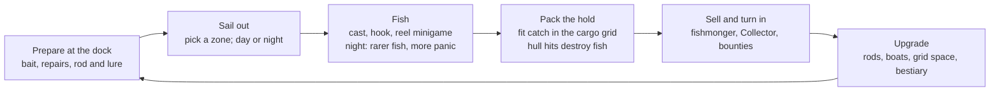
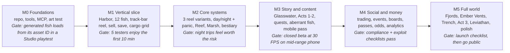

# Fishing Game PRD — Roblox (working title: Lantern Tide)

Back to [[Home]]

Nov 21, 2026 · @Evelynn

## 1. Overview

Lantern Tide is a Roblox fishing adventure set on shared servers. Fishing is calm and colourful by day and fog-bound and dreadful by night. Players pilot their own boat between islands, land each fish through a reel minigame that changes by species, pack the catch into a grid cargo hold, and slowly uncover what is wrong with the sea. "Lantern Tide" is a placeholder name.

**Design pillars**

1. **Every catch is earned.** Each fish is a short skill challenge, not a dice roll.
2. **Cozy day, creepy night.** The same world carries two moods, and the night pays better.
3. **Your boat is your home.** You upgrade it, fill it, and risk it.
4. **A sea worth uncovering.** A bestiary, aberrant fish and a central mystery pull players outward.

**References and what we take from them**

| Reference | We take | We avoid |
| --- | --- | --- |
| Fisch (Roblox) | Shared servers, rod collection, rarity tiers, fish mutations, bestiary, social hubs, events | Its fish names, art, maps and UI layouts |
| DREDGE (Steam) | Boat-first travel, Tetris-style cargo grid, night panic, aberrant fish, a lore-driven mystery | Its story, characters and creature designs |

All names, fish, characters, art and lore must be original. The references describe genre mechanics only.

**Decisions from the kickoff Q&A**

| Topic | Decision |
| --- | --- |
| Developer | Solo, experienced Luau developer, building with Claude Code |
| Mood | Cozy by day, creepy at night |
| Multiplayer | Shared servers (many players fish the same world) |
| Launch scope | Large: full world, quests, events, trading. It is reached through internal milestones (section 16). |
| Reel minigame | Mixed: variant depends on fish type and rod |
| DREDGE systems | All four: grid cargo, night panic, aberrant fish, story and mystery NPCs |
| Monetization | Gamepasses plus developer products |
| Platforms | PC and mobile at launch |
| Art | Claude Code builds 3D assets in Blender and UI in Figma |
| Travel | Player-owned, upgradable boats are the core way to travel |
| Timeline | No fixed deadline; ship when the quality bar is met |

**Out of scope for launch:** console and VR support, PvP combat, player housing on land.

## 2. Target players and platforms

The game targets Roblox players aged about 10 to 17 who enjoy collection and progression games, plus older players drawn by atmosphere and mystery. It launches on PC and mobile, so every system must work with touch alone.

| Segment | What they want | What serves them |
| --- | --- | --- |
| Collectors | Fill the bestiary, chase rare fish | Rarity tiers, mutations, aberrant variants, completion rewards |
| Grinders | Visible numbers going up | Rod, boat and cargo upgrades; money per hour that keeps rising |
| Explorers | New places and secrets | Islands, hidden spots, lore fragments, the night |
| Social players | Hang out and show off | Shared docks, catch announcements, trading, events |

**Session targets**

- First catch within 60 seconds of spawning.
- First sale and first upgrade within 10 minutes.
- A typical session runs 20 to 40 minutes, about one in-game day and night.

**Platform requirements**

- **PC:** mouse and keyboard; minigames use mouse click or Space.
- **Mobile:** every action has an on-screen button of at least 44 by 44 pixels. Minigames need a single tap or hold only. The UI scales to phone screens in portrait-safe areas.
- **Performance:** at least 30 FPS on a mid-range phone from 2022. Memory budget and streaming rules are in section 14.
- **Input:** built on Roblox's Input Action System so that one action map serves both platforms and leaves room for console later.

## 3. Core gameplay loop

Each trip turns risk at sea into upgrades at the dock. Bigger boats and better rods let players reach farther zones and survive longer nights, which pay more.



The loop runs at three time scales:

- **Seconds:** one catch, which is cast, wait, hook and reel (section 4).
- **Minutes:** one trip, from dock to sea and back, about one in-game day (20 real minutes).
- **Days and weeks:** bestiary completion, story acts, boat tiers, weekly leaderboards and events.

## 4. Fishing and the reel minigame

A catch has four phases: cast, wait, hook, reel. The server picks the fish when it bites, and the fish's data decides which reel variant plays. All variants use one input, so they work the same with a mouse button, Space or a single screen button.

**Phases**

1. **Cast.** Hold to charge a power meter and release to throw. Power sets distance. Some fish only bite far out or near structures.
2. **Wait.** Bite time is drawn from the zone's base time, changed by bait, rod Lure Speed, weather and time of day. The bobber idles with small fake nibbles.
3. **Hook.** On a real bite, a "!" prompt shows. The player must press within the hook window (default 0.9 s, shortened by fish difficulty). A miss means the fish leaves and the bait is kept.
4. **Reel.** The minigame for that fish runs. It ends in a catch, an escape, or a snapped line, which costs the bait.

**Reel variants**

| Variant | How it plays | Used for | Main tuning values |
| --- | --- | --- | --- |
| Track bar (Fisch-like) | Hold to raise a catch bar, release to let it fall. Keep the bar over the moving fish marker. Overlap fills progress; no overlap drains it. | Most common and small fish | barSize (from rod Control), fishSpeed, erraticness, gainRate, drainRate |
| Timing ring (DREDGE-like) | A needle spins around a dial. Press when it crosses a highlighted zone. Hits needed to land the fish; misses add strain. | Bottom-dwellers, shellfish, dredged items | needleRPM, zoneCount, zoneWidth, hitsRequired, missLimit |
| Tension line | Hold to reel in. Tension rises while reeling, faster when the fish runs. Release to ease off. Over 100% snaps the line; slack for too long lets the fish escape. | Large and strong fish | pullStrength, runInterval, lineStrength (rod), reelSpeed, slackLimit |
| Chained (aberrant and boss) | Two or three variants in a row, with visual distortion between phases. | Aberrant fish, legendary fish, event bosses | phase list, per-phase values, distortion intensity |

**Difficulty model.** Each fish has a difficulty from 1 to 10 and a variant. Its tuning values come from a per-variant difficulty curve, then the rod's stats adjust them. Tuning lives in one data module (`ReelTuning`) so balancing never touches code.

**Rod stats that affect reeling**

| Stat | Effect |
| --- | --- |
| Control | Larger catch bar; wider timing zones |
| Resilience | Slower progress drain; one extra allowed miss per 25 points |
| Line Strength | Higher snap limit in the tension variant |
| Reel Speed | Faster progress gain |
| Lure Speed | Shorter wait for bites (phase 2) |
| Luck | Better odds of rarer fish and mutations (section 5) |

**Rewards for skill**

- A **Perfect** catch (no misses, no drain below 50%) adds a Perfect tag worth +15% sell value and a sparkle effect.
- Each species tracks the player's perfect-catch count for bestiary mastery stars.

**Feel requirements**

- The minigame opens within 0.2 s of the hook press, with no screen change. It is an overlay near the bobber.
- Every hit, miss and tension spike has sound, camera shake and, on mobile, haptics.
- An optional Assist setting slows minigames by 25% for accessibility. It disables Perfect bonuses only.

**Server authority.** The client runs the minigame for responsiveness. The server chooses the fish, sends a seed and the tuning, and checks the result against a minimum plausible duration and the input log. Details are in section 14.

## 5. Fish, zones and the bestiary

The launch world has seven zones and about 100 base species, plus about 30 aberrant variants. Zone and species names below are placeholders to refine.

**Zones**

| # | Zone (placeholder) | Biome | Unlock | Species | Night twist |
| --- | --- | --- | --- | --- | --- |
| 1 | Driftwood Harbor | Sheltered bay, starter hub | Start | 12 | Lantern-fish swarms; first lore hint |
| 2 | Kelpshade Reef | Kelp forest and coral | Boat tier 1 | 14 | Bioluminescent reef, eels hunt |
| 3 | Mirelight Marsh | Mangrove swamp, brackish water | Boat tier 1 | 14 | Will-o'-wisp lights lure boats onto roots |
| 4 | Glasswater Shelf | Open ocean, deep swells | Boat tier 2 (hull) | 15 | Fog banks, shapes under the boat |
| 5 | Coldwake Fjords | Icy cliffs and floes | Boat tier 3 + heater | 15 | Ice closes in; cold drains panic faster |
| 6 | Ember Vents | Volcanic island, hot springs | Boat tier 3 | 15 | Vents erupt; rare heat-mutations |
| 7 | The Hollow Trench | Abyss over a sunken ruin | Story act 3 + depth gear | 15 | Source of the mystery; endgame aberrations |

**Rarity tiers.** Base weights before modifiers are shown below. Each zone draws from its own table, filtered by time, weather, cast distance and bait.

| Tier | Base chance | Value range (coins) |
| --- | --- | --- |
| Common | 55% | 5 to 30 |
| Uncommon | 25% | 25 to 80 |
| Rare | 12% | 70 to 250 |
| Epic | 5.5% | 200 to 900 |
| Legendary | 2% | 800 to 4,000 |
| Mythic | 0.5% | 3,500 to 20,000 |

**Fish data fields** (one entry per species in `FishData`): id, displayName, zones, rarity, activeTime (day, dusk, night, any), weather, castDistance range, preferred bait, reel variant, difficulty, weight range in kg, base value, cargo shape, bestiary lore text, model asset id.

**Mutations.** Each catch rolls a mutation independently of species. Rod Luck and some bait raise the odds.

| Mutation | Look | Value multiplier |
| --- | --- | --- |
| Giant | 1.5 to 2.5 times scale | x1.8 |
| Albino | White, pink eyes | x1.5 |
| Shiny | Gleaming sparkle | x2 |
| Glowing | Emissive; night only | x1.8 |
| Molten | Cracked lava skin; Ember Vents only | x2.5 |
| Frozen | Ice-crusted; Coldwake only | x2.5 |

**Aberrant fish (DREDGE-style).** About 30 species have a distorted aberrant form: extra eyes, wrong fins, translucent skin. All designs are original. They appear mostly at night, near taint spots, and in high-panic states.

- They sell for 3 to 5 times the base value, or can be turned in to a story NPC for lore and unique rewards.
- They always use a chained reel minigame.
- While one is in the cargo hold, panic rises 20% faster (section 7).

**Bestiary.** Every species shows as a silhouette with a hint until first caught. Each entry records count caught, heaviest weight, mutations found and perfect catches. Mastery stars come at 1 catch, 10 catches and 5 perfect catches. Completing a zone's page grants a title, a rod skin and coins. The bestiary is the main long-term collection goal.

## 6. Boats, cargo grid and travel

The boat is the player's base and their main progression track. Each player owns one or more boats and spawns one at any unlocked dock. Its hull grid holds both equipment and catch, so every upgrade is a trade-off for space.

**Piloting**

- PC: W/S for throttle, A/D to steer, Shift to boost (uses engine heat). Mobile: a thumbstick plus a boost button.
- The driver's client owns the boat's physics for smooth handling. The server checks speed and position against the boat's stats and corrects or kicks outliers.
- Friends may ride as passengers and fish from the deck. Their catch goes to their own carried bag, a small 3 by 2 grid.

**Hull damage and sinking**

- Rocks, ice and night hazards deal hull damage. Each hit destroys one random fish in the hold.
- At 0 hull HP the boat sinks. The player respawns at the last dock and loses all fish in the hold, but keeps equipment.
- Repairs cost coins at any dock. Disconnecting while sinking counts as sinking.

**Cargo grid**

- Each boat hull is a grid, for example 6 by 4 for the first boat. Fish and equipment are polyomino shapes: a small fish is 1 by 1, a medium fish 2 by 1, a large fish 3 by 2, and eels are L-shapes. Shapes can rotate.
- Rods, engines, lights and the ice box sit in the same grid. More gear means less room for fish.
- Drag and drop with snapping. Mobile adds a rotate button and an Auto-pack button that tries to fit everything.
- **Freshness:** fish lose 10% of their value per in-game day after the first day. An ice box slows this by half. Values are tunable.
- A dock **Stash** (8 by 6, upgradable) keeps trophy fish and spare gear between trips.

**Boat tiers** (names and numbers are placeholders for balancing)

| Tier | Boat | Grid | Hull HP | Top speed (studs/s) | Unlocks | Cost (coins) |
| --- | --- | --- | --- | --- | --- | --- |
| 0 | Rowboat | 4 x 3 | 60 | 14 | Harbor only | Free |
| 1 | Skiff | 6 x 4 | 100 | 26 | Reef, Marsh | 1,500 |
| 2 | Trawler | 8 x 5 | 180 | 30 | Glasswater Shelf | 12,000 |
| 3 | Icebreaker | 9 x 6 | 260 | 32 | Fjords, Ember Vents | 60,000 |
| 4 | Deepline | 10 x 7 | 340 | 36 | Hollow Trench (with depth gear) | 250,000 |

**Boat equipment**

| Slot | Examples | Effect |
| --- | --- | --- |
| Engine | Outboard, diesel, turbine | Top speed, boost length |
| Lights | Lantern, floodlight, ward-lamp | Slow panic at night; reveal hazards |
| Rod mounts | Extra rod holder | Run a passive trotline that catches small fish over time |
| Utility | Ice box, hull plating, sonar, dredge crane | Freshness, damage reduction, show fish schools, dredge salvage |

**Travel.** There is no fast travel. Distance and night risk are part of the game. Boats despawn after 5 minutes unattended at sea and return to the last dock with their cargo.

## 7. Day, night and panic

Night is the game's risk-for-reward layer. It pays better and feels worse. Time of day is shared by the whole server. Panic is tracked per player, and most horror effects show only to the panicking player.

**Cycle** (one full cycle is 20 real minutes; tunable)

| Phase | Length | Mood |
| --- | --- | --- |
| Day | 12 min | Warm light, gulls, calm music |
| Dusk | 2 min | Orange sky, music thins out, docks light their lanterns |
| Night | 5 min | Fog, low visibility, ambient drones, strange lights |
| Dawn | 1 min | Fog lifts, panic drains fast |

**Panic meter (0 to 100)**

- **Rises:** at sea during night (rate set per zone), faster with no lights on, 20% faster with an aberrant fish in the hold, spikes on hull hits.
- **Falls:** in daylight, at docks, near another player's boat lights, with better boat lights, and with a consumable such as Calming Tea.

| Panic | What happens |
| --- | --- |
| 0 to 24 | Normal night. Night-only fish are available. |
| 25 to 49 | Whispers, distant bells, the bobber twitches with no bite. |
| 50 to 74 | Hallucinations seen only by this player: fake rocks, phantom boats, fish that vanish from the hold display. |
| 75 to 99 | A hunter entity stalks the boat and attacks the hull unless the player outruns it or reaches light. |
| 100 | "The Deep takes notice": a large hull-damage event, then panic resets to 60. |

**Night rewards**

- Night-only species in every zone.
- Aberrant chance is 3 times higher; the Glowing mutation only rolls at night.
- Night-only quests and lore fragments.

**Tone guardrails.** The game is creepy, not gory. There is no blood and no character death on screen. A "Reduced scares" setting removes jump-scare audio and screen distortion. Before launch, fill in Roblox's content maturity questionnaire honestly; aim for the lowest label that fits mild fear content.

## 8. Story, NPCs and quests

The story is a mystery told in three acts across the seven zones. Progress is tracked per player, and cutscenes play locally, so the shared world never changes for others. The draft premise below is a placeholder for you to rewrite.

**Premise (draft).** The great lighthouse above Driftwood Harbor, the Lantern, went dark ten years ago. Since then the night sea has changed: fish come up wrong, lights move under the water, and boats come back with crews who won't talk. A hooded buyer has started paying well for the strange catches. The player arrives to fish, and slowly learns what sleeps beneath the Hollow Trench and why the Lantern was put out.

**Acts**

| Act | Zones | Story beat | Ends with |
| --- | --- | --- | --- |
| 1. The Quiet Harbor | Harbor, Reef, Marsh | Learn to fish, first aberrant catch, meet the Collector | Finding the Lantern keeper's logbook |
| 2. Wider Waters | Glasswater, Fjords, Ember Vents | Recover three lens shards from dangerous places, mostly at night | Relighting the Lantern for one night; the Trench opens |
| 3. The Hollow | Hollow Trench | Descend with depth gear, confront the source | A choice: seal the Deep or bargain with it. Each grants a different title, boat skin and epilogue. |

**Core NPCs** (all placeholders)

| NPC | Role | Gameplay function |
| --- | --- | --- |
| Harbormaster Wren | Gruff mentor | Tutorial, boat shop, repairs |
| Old Moss | Fishmonger | Sells fish, daily price board |
| Dr. Ilse Varga | Marine biologist | Bestiary rewards, research quests |
| The Collector | Hooded stranger, ambiguous | Buys aberrant fish, gives lore and rare rewards |
| Tackle shop owner | Cheerful merchant | Rods, bait, lures |
| Zone residents | One or two per island | Side quests and local lore |

**Quest types**

- **Main story:** about 25 quests across three acts. They gate Act 3 and give unique rewards.
- **Side quests:** 3 to 5 per zone, such as "catch a Giant fish here at night" or "deliver 5 fresh fish within one day".
- **Daily bounties:** three per day that reset at 00:00 UTC, scaled to the player's best boat tier.
- **Dredging relics:** salvage spots that need the dredge crane and a timing-ring minigame. They yield lore relics, materials and sellable junk.
- **Messages in bottles:** about 40 collectible lore fragments floating at sea, some only at night.

**Post-launch.** New chapters ship as live updates, each with a zone or sub-zone, 10 to 15 species and a short story arc.

## 9. Progression and economy

Progress runs on four tracks: Angler level, rods, boats and the bestiary. There is one soft currency (Coins) and one earned material (Relic Shards). There is deliberately no premium currency: Robux buys specific products directly (section 11), which keeps odds disclosure simple.

**Currencies and materials**

| Resource | Earned from | Spent on | Robux-purchasable? |
| --- | --- | --- | --- |
| Coins | Selling fish, bounties, quests | Boats, rods, bait, repairs, stash space, cosmetics | No (no coin packs at launch) |
| Relic Shards | Dredging, aberrant turn-ins, story | Top-tier rods and boat parts, rod tuning | No |

**Angler level.** XP comes from every catch, scaled by rarity, and from quests. The cap is 100 at launch. Levels gate gear purchases and give small rewards every 5 levels.

**Rods.** About 15 rods at launch.

- About 9 are bought with Coins and gated by level.
- 3 come from story or Collector rewards.
- 3 come from bestiary zone completion.
- Rod **tuning** spends Relic Shards to raise one stat by a fixed amount. It is deterministic, never random.

**Bait and lures.** Bait is consumable and bought with Coins. It changes rarity weights or targets species, such as "night crawlers raise Rare+ odds by 20% at night". Lures are reusable and give small stat buffs. They take a rod's lure slot.

**Sell price formula**

```
price = baseValue × weightFactor × mutationMult × perfectMult × freshness × marketMod
```

`marketMod` comes from Old Moss's daily board: 3 "hot" species at x1.5 and 2 "glut" species at x0.7, rotated each in-game day.

**Coin sinks:** boat and rod purchases, repairs, bait, stash expansion, cosmetics sold for Coins, and value lost to freshness.

**Pacing targets** (to check in playtests)

| Play time | Typical gear | Coins per hour | Next goal |
| --- | --- | --- | --- |
| 0 to 1 h | Starter rod, Rowboat | about 1,500 | Skiff |
| 1 to 5 h | Tier 2 rod, Skiff | about 6,000 | Trawler |
| 5 to 15 h | Tier 3 rod, Trawler | about 20,000 | Icebreaker |
| 15 to 35 h | Tier 4 rod, Icebreaker | about 50,000 | Deepline, Act 3 |
| 35 h and up | Endgame rods, Deepline | 100,000 and up | Mythics, bestiary completion, events |

## 10. Multiplayer and social

Servers hold up to 20 players in one shared world. Being near others is mildly rewarded, but fishing never requires a group.

**Social features**

| Feature | Spec |
| --- | --- |
| Catch announcements | Legendary and Mythic catches post a server-wide banner and show a trophy pose on the catcher. |
| Party bonus | Friends within 100 studs get +5% Luck and share light against panic at night. |
| Passengers | Up to 3 friends ride a boat (crew size grows with tier). The driver gets +10% coins per passenger's catch, and the passenger loses nothing. |
| Trading | Two-player trade window for fish and cosmetics only; rods, boats and Relic Shards cannot be traded. Both players confirm, then a 5-second countdown runs. The server validates and executes the trade in one atomic step. Players unlock trading at Angler level 15. |
| Leaderboards | Weekly heaviest catch per species, bestiary completion, total Mythics. Global boards use OrderedDataStore; in-server boards are live. |
| Server events | Run on a schedule or at random, about one an hour (list below). |
| Private servers | Offered at a low Robux price for groups of friends. |

**Server events**

- **Migration:** a school of a rare species surfaces at a marked spot for 5 minutes.
- **Pale Moon:** one night per hour where aberrant chance doubles and panic rises 50% faster.
- **Leviathan:** a server-wide boss fish. Up to 8 players take turns in its chained minigame; everyone who joins earns rewards based on contribution.
- **Storm:** heavy waves and lightning hazards, with storm-only fish.

**Safety and moderation**

- Chat uses TextChatService. Every player-written string (boat names, trade notes) goes through Roblox text filtering before anyone else sees it.
- Players can block others from trade requests and boarding their boat.
- No PvP. Boats pass through each other's hulls, so nobody can ram or grief.

## 11. Monetization

The game earns through gamepasses for permanent comfort and style, and developer products for short boosts and convenience. Nothing sold with Robux gates content, and no catch, boat or story step requires paying. Prices are placeholders.

**Gamepasses**

| Pass | Benefit | Price (R$) |
| --- | --- | --- |
| Harbor VIP | +10% sell price, name tag, VIP dock berth, daily free bait bundle | 399 |
| Big Stash | +50% dock stash size | 199 |
| Extra Boat Berth | Own and keep one more boat fitted out, for fast swaps | 249 |
| Paint Workshop | Custom boat and rod colours and decals | 149 |
| Deck Radio | Play tracks from the Roblox audio library on your boat | 99 |

**Developer products**

| Product | Effect | Price (R$) | Random? |
| --- | --- | --- | --- |
| Luck Charm (15 min) | +25% Luck for you | 49 | Yes: probability modifier |
| Server Luck (15 min) | +15% Luck for everyone on the server, buyer is credited | 199 | Yes: probability modifier |
| Hull Patch Kit | Instantly repair the hull at sea | 25 | No |
| Signal Flare | Reset your panic to 0 once | 25 | No |
| Cosmetic bundles | Specific rod and boat skins, sold directly | 99 to 499 | No |
| Private server | Monthly private server for friends | about 100 | No |

**Paid random items compliance.** Roblox treats luck boosts as paid random items. When a game sells them, it must show all possible outcomes with their real numeric odds as percentages that add up to exactly 100%. The odds must update while a boost is active.

- Each zone's catch table has an **Odds** panel, by rarity and by species, that the player can reach before buying a luck product.
- While any luck boost is active, that panel recomputes from the player's real modifiers.
- Before showing paid random items, check `PolicyService:GetPolicyInfoForPlayerAsync()` for regional restrictions, and hide those products where required.
- No randomized crates or gacha for cosmetics at launch.

**Purchase handling.** `MarketplaceService.ProcessReceipt` is idempotent: each `PurchaseId` is recorded in the player's profile before the reward is granted, and the receipt is only acknowledged after the save succeeds.

**Later options:** Premium Payouts (engagement-based, needs no work), rewarded video ads for a free Luck Charm if Roblox's ad products fit the audience, and seasonal passes with a free track.

## 12. UI and UX

The UI uses a warm nautical style: parchment panels, brass trim and hand-inked icons. As panic rises it shifts to cold, desaturated tones. Every screen is designed in Figma first at phone size (844 by 390) and PC size (1920 by 1080), then built in Roblox.

**Screens**

| Screen | Contents | Priority |
| --- | --- | --- |
| HUD | Coins, clock and day phase, panic meter, hull HP, cargo fill, active boosts, quest tracker | Must |
| Cast and reel overlay | Power meter, bite prompt, the three reel variants, Perfect feedback | Must |
| Catch card | Fish render, weight, mutation, rarity, value, "New!" bestiary stamp | Must |
| Cargo grid | Drag, rotate, auto-pack, discard, freshness indicators | Must |
| Dock stash | Grid like the cargo hold, transfer between the two | Must |
| Fishmonger | Sell all, sell selected, daily hot and glut board | Must |
| Shops | Rods, bait, lures, boats and parts with stat comparison | Must |
| Bestiary | Zone tabs, silhouettes, entry detail, mastery stars, odds link | Must |
| Quest log and dialogue | Story, side quests, bounties; NPC dialogue boxes | Must |
| Map | Discovered zones, docks, bottles found, event markers | Must |
| Odds panel | Rarity and species odds, live with boosts | Must (compliance) |
| Trade window | Two grids, confirm, countdown | Should |
| Robux store | Passes and products, with the odds link on luck items | Must |
| Settings | Audio, Reduced scares, Assist mode, graphics, UI scale | Must |

**Controls**

| Action | PC | Mobile |
| --- | --- | --- |
| Cast, hook, reel input | Left mouse button or Space | Large action button, bottom right |
| Steer boat | WASD | Thumbstick |
| Boost | Shift | Boost button |
| Open cargo | Tab | Cargo button on HUD |
| Rotate cargo item | R | Rotate button while dragging |
| Interact with NPC or dock | E | Context button |

**UX rules**

- Never more than two taps from the HUD to any must-have screen.
- The first session is a guided tutorial of 5 minutes or less: cast, reel, sell, buy bait, board the Skiff.
- Every purchase shows what changes before the player confirms.
- Text has a minimum size of 14 px on mobile, with high-contrast outlines over the 3D world.

## 13. Art, audio and the asset pipeline

Claude Code builds the art from scripts. That works best with a **stylized low-poly look**: simple shapes, flat or vertex colours, small palette textures. So that is the art direction. Fish, boats, props and rocks come from parameterized Blender generators, not hand-sculpting, so 130 fish come from one tool rather than 130 manual jobs.

**Art direction**

- Chunky, readable silhouettes; a warm palette by day, teal and violet fog by night.
- Aberrant fish reuse their base mesh plus generated deformations: extra eyes, spines, translucency.
- NPCs are R15 avatars with custom accessories, so there are no custom character rigs.
- Water is Roblox Terrain water. Mood comes from Lighting, Atmosphere, ColorCorrection and Bloom presets for each day phase.

**Pipeline**

1. **Style guide** in Figma: palette, rarity colours, polygon and texture budgets.
2. **Blender generators** in `art/blender/`: Python (bpy) scripts with parameters. Examples: `fish_gen.py` (body profile, fins, eyes, pattern, colours), `boat_gen.py` (modular hull, cabin and gear sockets), `rock_gen.py`, `dock_gen.py`.
3. **Iterate visually** through the Blender MCP server: Claude builds, takes viewport screenshots, and adjusts. Batch runs use headless Blender, which is the Steam build and is called by its full path: `& "E:\SteamLibrary\steamapps\common\Blender\blender.exe" -b -P art/blender/fish_gen.py -- --spec art/blender/specs/fish/kelp_snapper.json`. (see [[decisions/2026-11-22 Export fish as GLB modeled in studs]])
4. **Export** GLB (glTF binary, texture embedded), modeled in studs: 1 Blender unit = 1 stud, no export scale factor. Orient every fish with its head toward Blender −Y, which Roblox's importer turns into the MeshPart's LookVector. Name assets `FSH_KelpSnapper`, `BOT_Skiff_Hull`. Confirmed in the M0 smoke test: the test fish imported at exactly its Blender size. (see [[decisions/2026-11-22 Export fish as GLB modeled in studs]])
5. **Upload** through the Roblox Studio MCP's `open_cloud_invoke` tool, which calls the Open Cloud Assets API (`POST /assets/v1/assets`) and accepts .fbx, .gltf and .glb as Model assets. Files must sit in an approved upload folder (`art/blender/exports`, `art/figma`, `art/audio`). Claude polls the operation, checks the moderation state, and records each returned asset ID in `src/shared/Assets/AssetIds.luau` by hand. No API key is needed. Uploads are permanent on the account; only the Creator Dashboard can archive them. (see [[decisions/2026-11-21 Uploads go through the Studio MCP]])
6. **Place and wire up** in Studio through the Roblox Studio MCP server (insert, inspect, playtest, screenshot).

**Budgets for mobile**

| Asset | Triangles | Textures |
| --- | --- | --- |
| Fish | 300 to 1,500 | Shared palette atlas, 512 px |
| Boat (whole) | up to 8,000 | 1,024 px atlas |
| Rod | up to 1,000 | Palette atlas |
| Island prop | up to 2,000 | Palette atlas |
| Hero set piece (Lantern, Trench ruin) | up to 20,000 in parts | 1,024 px |

**Animation and VFX**

- Fish swimming and flopping are procedural: a scripted sine sway on the mesh or a few Bones. No keyframed fish animations.
- Player cast, reel and trophy poses: keyframed in Studio's Animation Editor, or drafted with Studio's AI animation generator (clips up to 10 s) and then polished.
- Splashes, bites, Perfect sparkles and the panic distortion use ParticleEmitters, Beams and screen-space UI effects.

**UI art.** Claude Code designs screens and components in Figma through the Figma MCP connector, exports PNGs at 2x, and uploads them as Images. Panels use 9-slice so one image scales to any size.

**Audio**

- SFX and ambience: the Roblox Creator Store audio library (cleared for use on Roblox), plus custom SFX generated with ElevenLabs and uploaded via Open Cloud. Check ElevenLabs' commercial-use terms for your plan.
- Music: two adaptive layers per zone (day and night) with a tension stem driven by panic. Use library tracks first; commission original music later if the game takes off.

**Estimated asset count:** about 130 fish meshes (100 base and 30 aberrant), 5 boats and about 25 boat parts, 15 rods, 10 NPC outfits, 7 island kits of 20 to 40 props each, and about 60 UI icons.

**Honest limits.** Scripted, low-poly modelling is reliable. Detailed organic sculpting, complex rigs and painterly textures are not. If a hero asset (the Lantern, the Leviathan) needs more polish, Studio's built-in mesh generation or a commissioned artist is the fallback. That choice can wait until those assets come up.

## 14. Technical architecture

The code lives in Git and syncs into Studio with Rojo. The server is authoritative for every roll, coin and item. Game data (fish, rods, boats, quests, tuning) lives in typed Luau data modules, separate from logic, so Claude Code can rebalance without touching systems.

**Stack**

| Concern | Choice |
| --- | --- |
| Sync and project | Rojo 7.7+ (`default.project.json`; 7.7.1 pinned in `rokit.toml`), Git, GitHub. `src/shared` maps to `ReplicatedStorage.Shared`, `src/server` to `ServerScriptService.Server`, `src/client` to `StarterPlayer.StarterPlayerScripts.Client`; server-only packages and `tests/` map to `ServerStorage`. Stripping dev packages from release builds is on the M5 launch checklist. (see [[decisions/2026-11-21 M0 toolchain and layout]]) |
| Language | Luau with `--!strict` in every file; the luau-lsp CLI (`luau-lsp analyze`, run by `tools/check.ps1`) type-checks it. Systems are tables with optional `Init` and `Start` functions, run in order by the shared Loader. (see [[decisions/2026-11-21 M0 toolchain and layout]]) |
| Packages | Wally: React and ReactRoblox (shared), ProfileStore (server), Jest and JestGlobals (dev). (see [[decisions/2026-11-21 M0 toolchain and layout]]) |
| Format and lint | StyLua, Selene |
| Tests | Jest Lua specs in `tests/` (`*.spec` modules, synced to `ServerStorage.Tests`) for pure modules (rolls, pricing, cargo packing). They run in Studio Edit mode through the Studio MCP: `execute_luau` with datamodel Edit, `return require(game.ServerStorage.Tests.RunTests:Clone())()`. Jest needs Studio's `FFlagEnableLoadModule`, which `tools/enable-jest-flag.ps1` sets; each Studio update drops it, so re-run the script and restart Studio. Jest can't run during Play (VM boundary error). Playtests (Play, console, screenshot) are a separate step. (see [[decisions/2026-11-21 Unit tests run in Studio Edit mode]]) |
| Networking | Zap (typed IDL that generates remotes), or plain RemoteEvents behind one validated wrapper |
| Player data | ProfileStore (session-locked DataStore wrapper) |
| UI | React Lua, matching the Figma components one to one |
| Input | Roblox Input Action System |
| Analytics | AnalyticsService funnel, economy and progression events |

**Project layout**

```
src/
  server/
    Services/        DataService, FishingService, CatchTableService, CargoService,
                     BoatService, TimeService, PanicService, QuestService, EconomyService,
                     MarketService, TradeService, EventService, BestiaryService,
                     MonetizationService, LeaderboardService, AnalyticsService
    init.server.luau  loads services in order
  client/
    Controllers/     InputController, FishingController, MinigameController,
                     CargoController, BoatController, PanicFXController,
                     LightingController, AudioController, TutorialController
    UI/              React Lua apps and components
    init.client.luau
  shared/
    Data/            FishData, ZoneData, RodData, BaitData, BoatData, QuestData,
                     ReelTuning, EconomyConfig, MonetizationConfig
    Modules/         CatchRoll, PriceCalc, CargoGrid, Shapes, Seeded RNG, Types
    Assets/          AssetIds.luau (filled in by hand after each MCP upload)
    Net/             generated Zap code
art/blender/         generators, specs/<kind>/*.json, previews/ (PNGs, committed), exports (git-ignored)
art/figma/           exported UI PNGs
art/audio/           audio files for upload
studio/              the developer's own Studio files, kept as is
docs/plans/          approved plans
tools/               check.ps1 (StyLua + Selene + luau-lsp), enable-jest-flag.ps1, balance sims, data validators;
                     upload_assets.py only if the MCP upload route can't do a job
tests/               Jest specs (*.spec) and jest.config.luau
```

(see [[decisions/2026-11-21 Uploads go through the Studio MCP]] and [[decisions/2026-11-21 M0 toolchain and layout]])

**Catch flow and anti-cheat**

1. The client sends `RequestCast(power)`. The server records the time, position and equipped gear.
2. The server rolls bite time, species, weight and mutation with `CatchRoll`, using the zone table, gear, bait, boosts, time and weather.
3. At bite time the server sends `Bite(fishToken, variant, tuning, seed)`.
4. The client runs the minigame and sends `ReelResult(fishToken, outcome, inputLog)`.
5. The server checks: the token is live and belongs to this player; the duration is at least the minimum for that tuning; the input log is plausible; the rate is at most one catch per 3 s. Only then does it insert the fish into the cargo grid.

**Other server rules**

- Every remote checks types, range and rate. Clients never send prices, odds, coin amounts or item IDs to grant.
- Boat speed and position are checked against stats; teleports outside docks are rejected.
- Trades lock both profiles and run as one atomic swap; a failure rolls back.
- Cargo placement is checked on the server with the same `CargoGrid` module the client uses.

**Player profile (sketch)**

```
{ version, coins, relicShards, anglerXP, level,
  rods = { [rodId] = { tuning } }, equippedRod, bait = { [baitId] = count },
  boats = { [boatId] = { hullHP, parts, cargo = { items } } }, activeBoat,
  stash = { items }, bestiary = { [fishId] = { count, heaviest, mutations, perfects } },
  quests = { story, side, bounties, lastBountyReset }, flags, settings,
  purchases = { [purchaseId] = true }, stats }
```

The profile carries a `version` field with migration functions for every schema change.

**Performance**

- StreamingEnabled, with each island as an Atomic model streamed by distance.
- Fish in the world are client-side visuals; the server only holds data.
- Check client memory and frame time on a low-end phone with the Developer Console at every milestone.

## 15. Tools and setup

You need a Windows or macOS computer, since Roblox Studio does not run on Linux. Everything required is free except Claude Code. Three MCP servers let Claude Code drive Roblox Studio, Blender and Figma directly.

**Required**

| Tool | Purpose | Cost | Setup notes |
| --- | --- | --- | --- |
| Roblox Studio (latest) | Engine, playtesting, publishing | Free | Turn on its MCP server: Assistant Settings, then MCP Servers, then Quick connect, then Claude Code |
| Claude Code | Writes code, data, generators; drives the MCP tools | Claude subscription | Run it in the repo root; keep `CLAUDE.md` and this PRD there |
| Roblox Studio MCP (built in) | Read and edit scripts, inspect instances, run Luau, start and stop playtests, take screenshots, generate meshes and animations | Free | Every call needs a `studio_id`; use `list_roblox_studios` when several Studio windows are open |
| Rojo 7.7+ (CLI and Studio plugin) | Sync files from Git into Studio | Free | 7.7 added syncback and websocket sync |
| Rokit | Pins versions of Rojo, Wally, StyLua, Selene, Lune, Zap and luau-lsp per project | Free | `rokit.toml` is committed to the repo (Rokit 1.2.0; Rojo 7.7.1, Wally 0.3.2, StyLua 2.6.0, Selene 0.32.0, Lune 0.11.1, Zap 0.6.29, luau-lsp 1.70.1). Lune runs Luau outside Studio for data validation and balance simulations. (see [[decisions/2026-11-21 M0 toolchain and layout]]) |
| Wally, StyLua, Selene, luau-lsp | Packages, formatting, linting, types | Free | Installed through Rokit; luau-lsp in VS Code, and its CLI runs from `tools/check.ps1` |
| Git and GitHub | Version control, backups, issues as the task board | Free | Commit at least once per feature |
| Blender 5.3 | Fish, boat, prop and island modelling via Python generators | Free | Use the same version on every machine. The Steam build is at `E:\SteamLibrary\steamapps\common\Blender\blender.exe` and is not on PATH. (see [[decisions/2026-11-21 M0 toolchain and layout]]) |
| Blender MCP ("MCP for Blender" add-on) | Lets Claude Code build in Blender and see the viewport | Free | Install the add-on in Blender and register it with Claude Code; it updates with `uvx mcp-for-blender install-addon`. Needs Python 3.10+ and uv. Run only one MCP client against it at a time. (see [[decisions/2026-11-21 M0 toolchain and layout]]) |
| Figma (free plan is enough to start) | Style guide, UI screens, icons | Free | Create one file: "Lantern Tide UI". Starter plans get about 20 MCP calls a month for tools that read designs (`whoami` and `create_new_file` don't count): enough for M0, too few for UI-heavy milestones. (see [[decisions/2026-11-21 M0 toolchain and layout]]) |
| Figma MCP server | Lets Claude Code create and read Figma frames and export assets | Free with Figma | Use the claude.ai Figma connector (already signed in). The monthly call limit above applies. (see [[decisions/2026-11-21 M0 toolchain and layout]]) |
| Roblox Open Cloud API key | Upload models, images and audio from scripts | Free | Not needed unless the Studio MCP upload route can't do a job. If one is ever created: scope Assets read and write, for your user or group, stored in `.env`, never in Git. (see [[decisions/2026-11-21 Uploads go through the Studio MCP]]) |

**Optional**

| Tool | Use |
| --- | --- |
| VS Code | Read and edit code yourself alongside Claude Code |
| ElevenLabs | Generate custom SFX and ambience |
| A Roblox group | Own the game and assets under a group for later collaborators and revenue splits |

**First-day setup checklist**

- [x] Install Studio, Blender, Git, Python 3.10+ and uv, Rokit, VS Code
- [x] Create the GitHub repo (private; remote `origin`)
- [x] Run `rojo init`; add `rokit.toml`, `wally.toml`, `selene.toml`, `stylua.toml`
- [x] Turn on the Studio MCP server and connect Claude Code through Quick connect
- [x] Install the Blender MCP add-on and register it with Claude Code
- [x] Connect Figma's MCP server
- [ ] Create the Figma UI file "Lantern Tide UI" (with the first UI work)
- [ ] Create an Open Cloud API key and save it in `.env` (not needed, see [[decisions/2026-11-21 Uploads go through the Studio MCP]])
- [x] Add this PRD as `docs/PRD.md` and write `CLAUDE.md` (section 18)
- [x] Run a smoke test: Claude creates a part through MCP, generates a test fish in Blender, uploads it and inserts it into Studio (done 2026-11-22: see [[playtests/2026-11-22 M0 fish smoke test]])

Checklist status is recorded in [[decisions/2026-11-21 M0 toolchain and layout]].

**Sources:** [Roblox Studio MCP docs](https://create.roblox.com/docs/studio/mcp) · [Open Cloud Assets API guide](https://create.roblox.com/docs/cloud/guides/usage-assets) · [blender-mcp](https://github.com/ahujasid/blender-mcp) · [Rojo 7.7.0 release](https://sourceforge.net/projects/rojo.mirror/files/v7.7.0/) · [Paid random items policy](https://create.roblox.com/docs/production/monetization/paid-random-items)

## 16. Milestones and roadmap

The large launch scope is reached through six gated milestones, with no fixed dates. M1, the vertical slice, is the most important gate: if the first 10 minutes aren't fun with one zone, more zones won't fix it.



The M0 gate loads the generated fish from its ID in `AssetIds.luau`, spawned by a Studio-only SmokeTestService. Catching it (cast, hook, reel) is M1's job. (see [[decisions/2026-11-21 M0 gate reworded]])

**Rules for every milestone**

- Each milestone becomes GitHub Issues, one per system or asset batch, linked to the PRD section it implements.
- A milestone is done only when its gate passes in a real playtest on PC and a phone.
- If scope must shrink, cut a zone (Coldwake or Ember Vents) before cutting reel, cargo or panic polish.

## 17. Success metrics, risks and open questions

The launch succeeds if new players stay past the first day and feel the night is worth the risk. The targets below are starting goals to revisit after the closed test.

**Metrics** (tracked with AnalyticsService)

| Metric | Target |
| --- | --- |
| Tutorial completion | 80% or more |
| Day-1 retention | 30% or more |
| Day-7 retention | 10% or more |
| Average session length | 20 minutes or more |
| Players who try at least one night trip in session 1 | 50% or more |
| Payer conversion | 2 to 4% |
| Exploit reports per 1,000 players per week | Fewer than 1 |

**Risks**

| Risk | Impact | Mitigation |
| --- | --- | --- |
| Large scope for a solo developer | Launch keeps slipping | Strict milestone gates (section 16); a closed test after M3 with 3 zones; cut zones before cutting polish |
| Procedural art looks generic | Weak store thumbnails, low click-through | Lock the style in M1 with a vertical slice; budget a commissioned key art and thumbnail |
| Exploiters fake catches or coins | Broken economy, unfair leaderboards | Server-authoritative design (section 14); rate limits; log anomalies to a review DataStore |
| Paid random items non-compliance | Moderation action against the game | Odds panel and PolicyService checks built before any luck product goes live |
| Night horror too intense for young players | Bad reviews, higher maturity label | Reduced-scares setting; no gore; test with younger players |
| Mobile performance in fog-heavy scenes | Low FPS, players quit | Per-zone budgets; Atmosphere and particle limits on low graphics quality |
| Discovery on Roblox | Few players find the game | Short-form video of aberrant catches; events at launch; thumbnails A/B tested |

**Open questions**

- [ ] Final game name, and should the story premise be rewritten?
- [ ] Server size: 20 players, or fewer for performance with many boats?
- [ ] Trading at launch, or one update after launch once the economy is stable?
- [ ] Commission music and key art before launch, or after it proves itself?
- [ ] Group-owned or personally owned game?

## 18. Using this PRD with Claude Code

Export this doc as Markdown into `docs/PRD.md` in the repo. Then add a short `CLAUDE.md` so every Claude Code session starts with the same rules. Work one milestone at a time and one system per session.

**Starter CLAUDE.md**

```markdown
# Lantern Tide — Roblox fishing game
Read docs/PRD.md before planning any feature. Current milestone: M1 (see PRD §16).

## Stack
Rojo 7.7 · Luau --!strict · Wally · StyLua + Selene · Zap · ProfileStore · React Lua · Input Action System

## Rules
- Server is authoritative for every roll, coin and item. Clients never send prices, odds or rewards.
- Game data lives in src/shared/Data/*. Never hard-code tuning in systems.
- Pure logic (CatchRoll, PriceCalc, CargoGrid) gets Jest Lua tests before use.
- Run stylua and selene before every commit; fix all warnings.
- After each feature: playtest through the Roblox Studio MCP (start play, read console,
  screen_capture), then report what you saw.
- Art: generate with art/blender/*.py through Blender MCP; low-poly palette style; respect
  PRD §13 budgets. Upload with tools/upload_assets.py; never commit .env.
- UI: design in Figma first (file "Lantern Tide UI"), then build with React Lua.
- All names, fish, characters and lore are original. Never copy Fisch or DREDGE content.
```

**Session workflow**

1. Start in plan mode: "Read PRD §4 and plan the Track-bar reel variant. List files, data and tests."
2. Approve or edit the plan, then let Claude Code implement it with tests.
3. Ask for a Studio playtest through MCP, with a screenshot and console output.
4. Play it yourself and give feel notes, such as "the bar falls too fast; the bite window feels short".
5. Commit, tick off the milestone item in GitHub Issues, and move on.

**Good first prompts**

- "Set up the repo from PRD §14 and §15: Rojo project, Rokit tools, Wally packages, folder layout, a service loader and one passing test."
- "Write `fish_gen.py` for Blender, generate 3 sample fish from JSON specs, render previews, export FBX."
- "Build `CargoGrid` with polyomino shapes, rotation and auto-pack, with tests, then the drag-and-drop UI for PC and touch."
- "Design the HUD and catch card in Figma at 844 by 390 and 1920 by 1080 using the style guide."

**Keep the PRD alive.** When a playtest changes a design decision, update this doc first, then re-export `docs/PRD.md`, so Claude Code never builds from stale rules.
